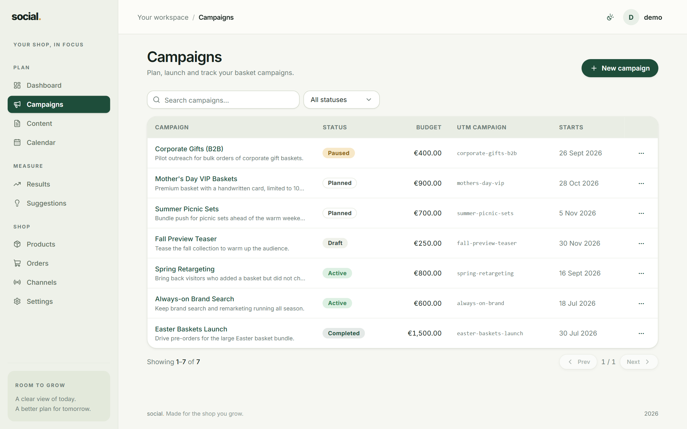
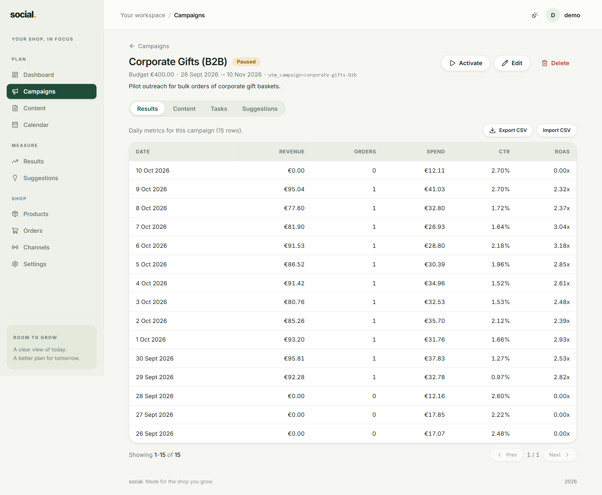

# Campaigns

A campaign is one push with a budget and a period: *"Fall baskets, €500, October"*. Everything
else in the app — content, results, suggestions — hangs off a campaign.

## The campaign list



- **Search** filters by name as you type.
- **All statuses** narrows the list to one status.
- **New campaign** creates one.

The table shows the campaign name, its status badge, its budget, its **UTM campaign** name and
its start date. Click any row to open the campaign.

## Creating and editing

Press **New campaign** (or **Edit** on a campaign page) and fill in:

| Field | Required | Notes |
| --- | --- | --- |
| **Name** | Yes | What you call it. Up to 255 characters. |
| **Objective** | No | What "working" means for this campaign, in your own words. |
| **Budget (€)** | Yes | A number like `500` or `500.00`. This is a plan, not a hard limit. |
| **Status** | Yes | Defaults to `Draft`. See below. |
| **Start date** / **End date** | No | The end date cannot be before the start date. |
| **UTM campaign** | No, but see below | The tag you will put in your links. |

## Statuses

| Status | Use it when |
| --- | --- |
| **Draft** | You are still writing the plan. Nothing is running yet. |
| **Planned** | It is agreed and scheduled, but has not started. |
| **Active** | It is running right now. This is the status the Dashboard cares about. |
| **Paused** | You stopped it temporarily (budget, stock, a bad week). |
| **Completed** | It is finished. Keep it for the history. |

You can change status in two places: the **Status** field when editing, or the
**Activate / Pause** button on the campaign page. Use the button for the quick day-to-day
toggle — it updates instantly without opening the form.

## The UTM campaign field

This is a short label, like `fall-baskets`, that you also put in the links you post:

```
https://your-shop.com/product/basket?utm_source=instagram&utm_medium=social&utm_campaign=fall-baskets
```

The app uses it in two ways:

- **Google Analytics sync** matches incoming rows to campaigns by this name (ignoring upper
  and lower case).
- **Orders** imported from your shop are attributed to a campaign using the same tag.

Rules of thumb:

- Lowercase, words separated by hyphens: `fall-baskets`, `xmas-gift-guide`.
- No spaces, no accents, no punctuation.
- **One campaign = one name.** Never reuse a name across two campaigns — you will not be able
  to tell their results apart.
- Use the same name in *every* link for that campaign.

!!! tip "Build the link, don't guess it"
    [Settings → UTM builder](settings.md#utm-builder) assembles the tagged URL for you, so the
    spelling always matches.

## The campaign page



Opening a campaign gives you a header with its budget, dates and UTM campaign, plus four tabs:

=== "Results"

    The daily metrics for this campaign only — date, revenue, orders, spend, CTR and ROAS —
    with **Export CSV** and a link to import more. See [Results](results.md).

=== "Content"

    Every content item planned or published for this campaign, with **New content** to add
    one. See [Content & calendar](content-calendar.md).

=== "Tasks"

    A simple to-do list for this campaign: type a task, optionally give it a due date, and
    tick it off when done. Overdue tasks are flagged in red. Accepting a
    [suggestion](suggestions.md) creates a task here automatically.

=== "Suggestions"

    **Generate rules** reads your own numbers and proposes next steps; **Generate AI** does
    the same with written advice (needs an OpenAI key). See [Suggestions](suggestions.md).

## Deleting a campaign

**Delete** on the campaign page removes the campaign **and its results, content, tasks and
suggestions**. There is no undo, so if you only want to stop it, set the status to
**Completed** or **Paused** instead.
