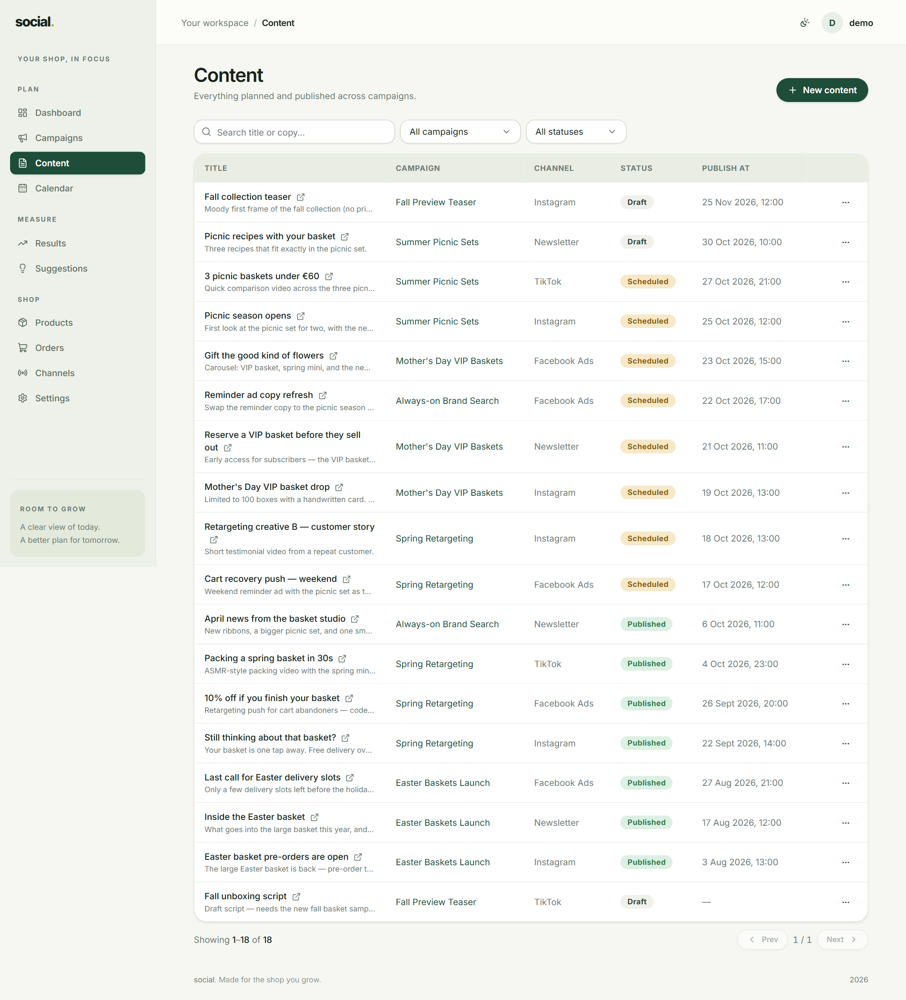
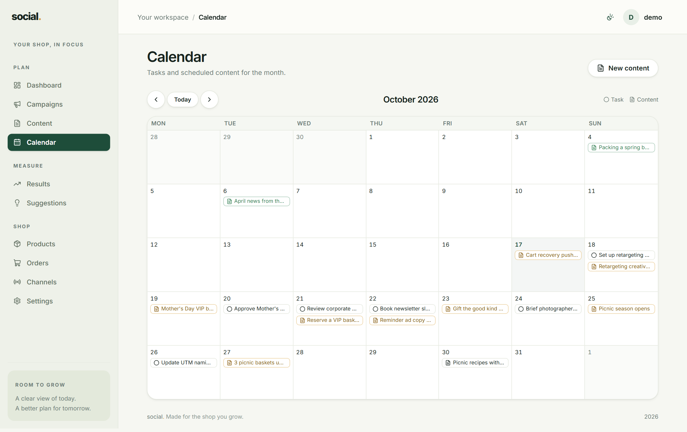

# Content & calendar

Two views of the same thing: **Content** is a searchable list, **Calendar** is the month at a
glance. Use Content to find and edit a specific post; use Calendar to see whether next week is
empty.

## Content



Filter by **campaign** and **status**, or search across the title and the caption text. The
table shows each item's title, campaign, channel, status and publish date.

Press **New content item** to create one.

## Creating a content item

| Field | Required | Notes |
| --- | --- | --- |
| **Campaign** | Yes | Which campaign this post belongs to. |
| **Channel** | No | Where it will be published, or *No specific channel*. |
| **Title** | Yes | For your own reference, e.g. `TikTok hook video #2`. |
| **Copy / caption** | No | The actual caption text, hashtags and call to action. |
| **Status** | Yes | `Draft`, `Scheduled` or `Published`. |
| **Publish at** | No | The date and time it should go live. This is what places it on the calendar. |
| **Link** | No | Where the post points — the shop page or landing page. |
| **Asset URL** | No | A link to the image or video file. |
| **UTM source / medium / campaign** | No | The tags for the link you will post. |

### Statuses

| Status | Meaning |
| --- | --- |
| **Draft** | An idea or a work in progress. Nothing is scheduled. |
| **Scheduled** | It is written and has a publish date. |
| **Published** | It is live. |

Keep items as **Draft** while you are still writing them, and switch to **Scheduled** once the
publish date is set — then you can trust the calendar to show only what is really planned.

### The tagged link preview

As soon as you fill in the **Link** and the UTM fields, a small *Tagged link preview* appears
underneath showing the exact URL that will carry your tracking tags:

```
https://your-shop.com/product/basket?utm_source=instagram&utm_medium=social&utm_campaign=fall-baskets
```

Copy it from there when you post. If you leave the UTM fields empty, the preview does not
appear — and any visit from that post will not be attributable to the campaign.

!!! tip "Match the campaign's own UTM name"
    Type the campaign's **UTM campaign** value here exactly as it is on the campaign. The
    [UTM builder](settings.md#utm-builder) in Settings does the same job if you would rather
    build the link somewhere else.

## Calendar



The calendar shows one month at a time, with:

- **Scheduled and published content**, placed on its publish date.
- **Tasks** that have a due date, so you can see what you owe the campaign this week.

Use **‹**, **Today** and **›** to move between months. Click a day to open a small panel where
you can add a task or a content item straight onto that date — no need to go back to the
campaign page first.

!!! note "Only dated items appear"
    Content without a **Publish at** date and tasks without a **due date** will not show on the
    calendar. That is the quickest way to find things you forgot to schedule.
