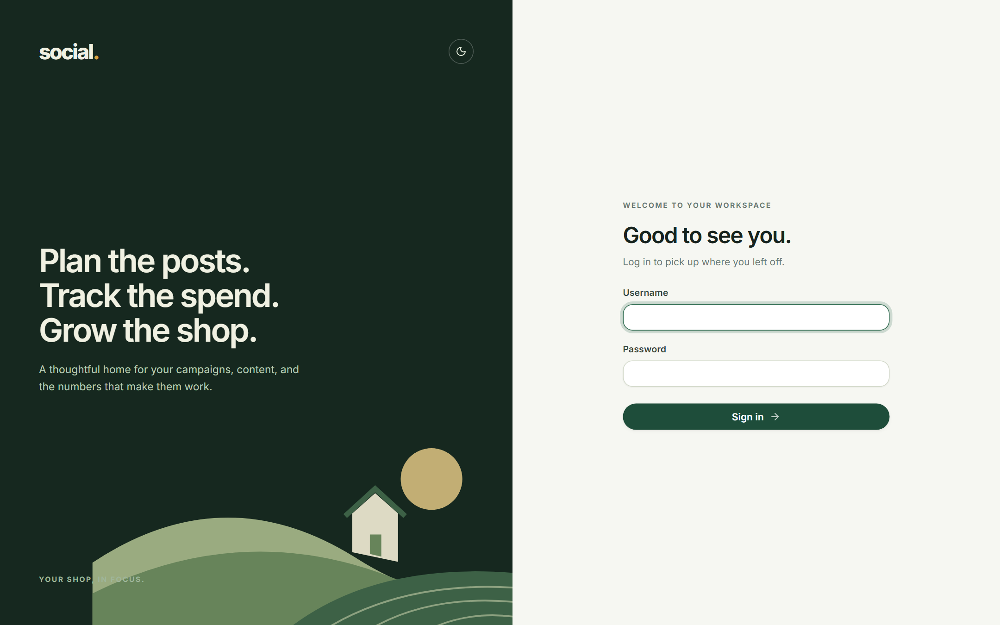
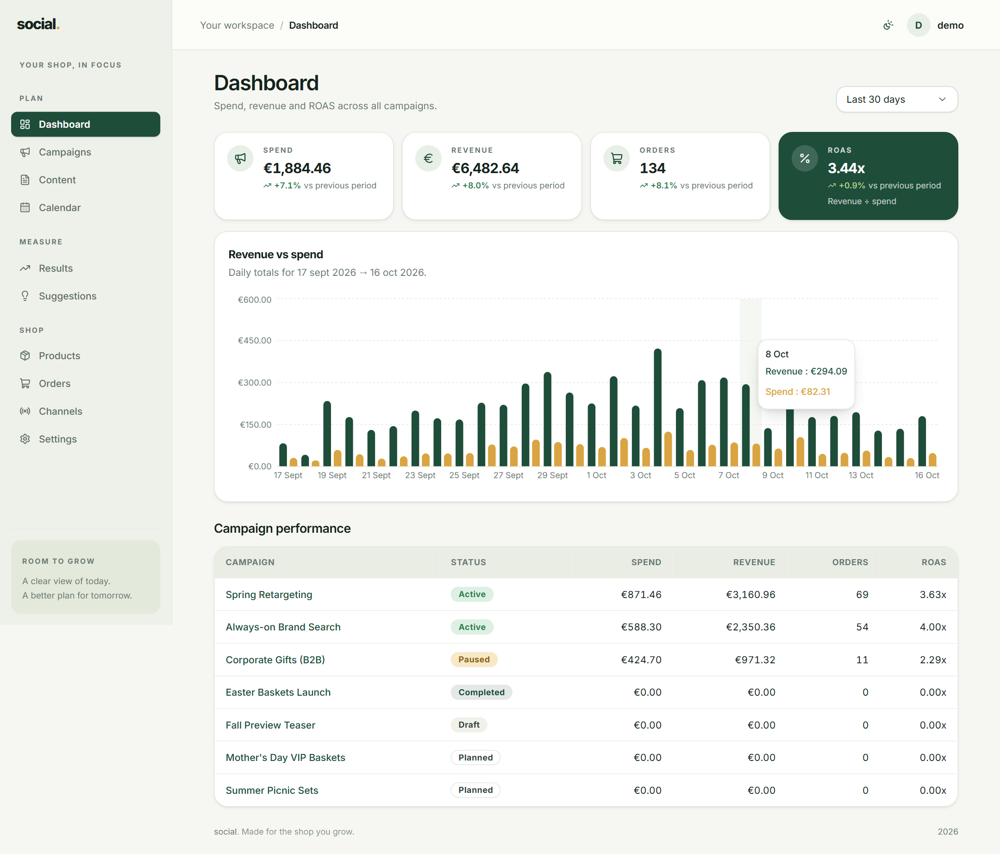

# Getting started

This page takes you from "I have a login" to "my Dashboard shows numbers" in about fifteen
minutes. Follow it in order — each step feeds the next one.

## 1. Sign in

Open the app in your browser and sign in with the **username** and **password** you were
given. There is no email step and no "forgot password" link — if you are stuck, ask whoever
set the app up to reset it for you.



*The sign-in screen.*

!!! note "There is no public sign-up"
    Accounts are created for you by whoever runs the app. If you open the sign-up page you
    will usually see *"Registration is disabled"* — that is expected, not a fault.

## 2. Create a channel

Channels are where your content gets published: Instagram, TikTok, Google, and so on. You
need at least one before you can plan content.

Go to **Shop → Channels → New channel** and fill in:

| Field | Example | Notes |
| --- | --- | --- |
| **Name** | `Main Instagram` | Anything you recognise. |
| **Type** | `Instagram` | Facebook, Instagram, TikTok, Google, X or Other. |
| **Handle** | `@your.shop` | Optional. |

## 3. Create your first campaign

Go to **Campaigns → New campaign**.

| Field | Example | Notes |
| --- | --- | --- |
| **Name** | `Fall baskets` | What you will call it internally. |
| **Objective** | `Sell the new basket bundle` | Optional, but useful later. |
| **Budget (€)** | `500` | Planned spend, not a hard limit. |
| **Status** | `Active` | See [Campaigns](campaigns.md) for what each status means. |
| **Start / end date** | `2026-10-01` → `2026-10-31` | The period the campaign runs. |
| **UTM campaign** | `fall-baskets` | **The most important field.** Lowercase, hyphens, no spaces. |

!!! tip "Set the status to Active when it starts running"
    The Dashboard and Suggestions treat `Active` campaigns as the ones worth looking at.
    `Draft` is for something you are still writing.

## 4. Tag your links

This is the step people skip, and it is the one that makes everything else work.

Go to **Settings → UTM builder**, paste the link you are about to post, and fill in the
campaign name. The builder gives you back a tagged link like:

```
https://your-shop.com/product/basket?utm_source=instagram&utm_medium=social&utm_campaign=fall-baskets
```

Copy that and use it wherever you post the link. Now visits and orders can be traced back to
`Fall baskets`. More in [Settings → UTM builder](settings.md#utm-builder).

## 5. Plan some content

Go to **Content → New content item** (or add it from the campaign page). Give it a campaign,
a channel, a title, and a **Publish at** date. See [Content & calendar](content-calendar.md).

## 6. Record your results

Now the part that puts numbers on the Dashboard. Go to **Results**. You have two options:

=== "Import a CSV"

    Most ad platforms let you export a daily report. Save it, then drag it onto the
    **Metrics CSV** card in Results. The exact columns are listed in
    [Results](results.md#importing-a-csv).

=== "Let Google Analytics do it"

    If the app has been connected to Google Analytics 4, open **Settings → API keys** and
    press **Sync now**. The last 7 days of revenue and orders are pulled in automatically.
    Setup is described in [Settings → API keys](settings.md#api-keys).

## 7. Read the Dashboard

Open **Dashboard**. You should now see your spend, revenue, orders and ROAS for the last 30
days, a revenue-vs-spend chart, and a row per campaign.



*The Dashboard, with the default 30-day range.*

If a card still shows `€0.00` or `—`, the most common causes are:

- No rows recorded for the selected period → widen the range to **All time**.
- Revenue recorded but no spend → ROAS cannot be calculated yet (see [Results](results.md)).
- The campaign's `utm_campaign` does not match what is in your links → see
  [Troubleshooting](faq.md).

## 8. Get suggestions

Open your campaign and go to the **Suggestions** tab. Press **Generate rules** — this works
with no setup at all and reads your own numbers. If an OpenAI key has been added, **Generate
AI** gives you written recommendations too. Accepting a suggestion turns it into a task.
More in [Suggestions](suggestions.md).

---

**Next:** [Dashboard](dashboard.md) → [Campaigns](campaigns.md) → [Results](results.md)
