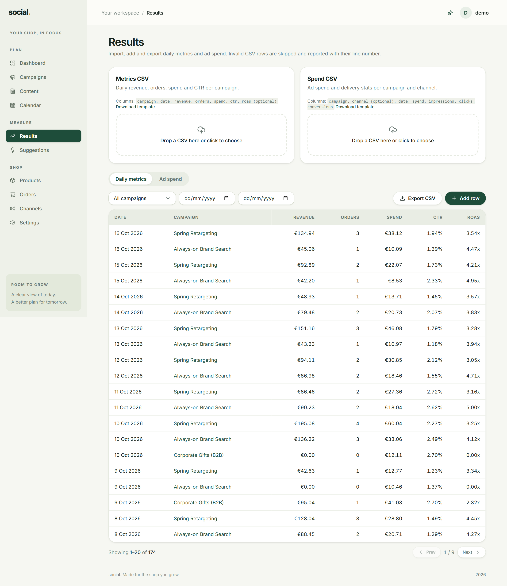

# Results & reporting

**Results** is where numbers enter the app. Everything you see on the
[Dashboard](dashboard.md) comes from here.



*The Results page: import cards on top, the day-by-day table below.*

There are two tabs:

| Tab | Holds | Feeds |
| --- | --- | --- |
| **Daily metrics** | Revenue, orders, spend, CTR and ROAS per campaign and day. | The Dashboard: spend, revenue, orders, ROAS. |
| **Ad spend** | Spend plus impressions, clicks and conversions per campaign, channel and day. | The detailed spend ledger (per-channel delivery stats). |

!!! warning "The Dashboard reads *Daily metrics*, not *Ad spend*"
    If you want the Dashboard's **Spend** and **ROAS** cards to be right, the numbers have to
    be in the **Daily metrics** tab — the `spend` column is what ROAS is calculated from. The
    **Ad spend** tab is a richer per-channel ledger (impressions, clicks, conversions) and is
    kept separate from the Dashboard totals.

## Three ways data gets in

=== "Add a row by hand"

    Best for a single day you want to correct or fill in.

    1. Open the **Daily metrics** (or **Ad spend**) tab.
    2. Press **Add row**.
    3. Fill in the campaign, date and numbers, then save.

    In the metrics dialog, **ROAS is calculated for you** from revenue ÷ spend — you will see
    it previewed under the fields. You cannot type it directly.

=== "Import a CSV"

    Best for a weekly or monthly batch exported from your ad platform. See
    [Importing a CSV](#importing-a-csv).

=== "Sync from Google Analytics"

    Best if the app has been connected to GA4: press **Sync now** in
    [Settings → API keys](settings.md#api-keys) and the last 7 days of revenue and orders are
    pulled in. See [Syncing from Google Analytics](#syncing-from-google-analytics).

## Importing a CSV

At the top of Results there are two cards, one per tab. Each has the exact column list, a
**Download template** link, and a drop zone: *"Drop a CSV here or click to choose"*.

### Daily metrics CSV

| Column | Required | Notes |
| --- | --- | --- |
| `campaign` | Yes | The campaign **id** (a number), not its name. `campaign_id` also works. |
| `date` | Yes | `YYYY-MM-DD`, e.g. `2026-10-01`. |
| `revenue` | No | Number, `0` or more. Defaults to `0`. |
| `orders` | No | Whole number, `0` or more. Defaults to `0`. |
| `spend` | No | Number, `0` or more. Defaults to `0`. |
| `ctr` | No | A percentage as a number, e.g. `0.4` for 0.4%. Defaults to `0`. |
| `roas` | No | Leave it out and it is calculated as revenue ÷ spend. |

Sample file:

```csv
campaign,date,revenue,orders,spend,ctr
1,2026-10-01,120.00,4,40.00,0.4
```

### Ad spend CSV

| Column | Required | Notes |
| --- | --- | --- |
| `campaign` | Yes | The campaign **id**. `campaign_id` also works. |
| `channel` | No | The channel **id**. `channel_id` also works. Leave empty for "not channel-specific". |
| `date` | Yes | `YYYY-MM-DD`. |
| `spend` | No | Number, `0` or more. |
| `impressions`, `clicks`, `conversions` | No | Whole numbers, `0` or more. |

```csv
campaign,channel,date,spend,impressions,clicks,conversions
1,1,2026-10-01,30.00,1000,50,5
```

### What happens after an import

You get a short summary, for example *"Imported: 12 new, 3 updated. 2 row(s) skipped."* Skipped
rows are listed in a table with their **line number** (line 1 is the header) and the exact
problem, so you can fix the file and re-import it.

Good to know:

- **Re-importing is safe.** A row for the same campaign and date **updates** the existing one
  instead of creating a duplicate. Import the same file twice and nothing doubles.
- **Importing marks rows as manual.** If a row had been pulled in from Google Analytics, a
  later CSV import for the same campaign and date replaces it and marks it manual.
- **Bad rows never stop the good ones.** Each valid row is saved on its own.

!!! tip "Find the campaign id"
    Open a campaign and look at the address bar: `/campaigns/12` means the id is `12`. The
    **UTM campaign** column on the campaigns list is *not* the id.

## The tables and filters

Both tabs work the same way:

- **Filter** by campaign, and by a from/to date range.
- **Export CSV** downloads exactly what the filters are showing — the file can be edited and
  imported straight back.
- Rows are newest first, 25 per page.

The metrics table shows date, campaign, revenue, orders, spend, CTR and ROAS. The spend table
shows date, campaign, channel, spend, impressions, clicks and conversions.

## Syncing from Google Analytics

If the app has been connected to Google Analytics 4 (see
[Settings → API keys](settings.md#api-keys)), you do not need to export anything:

1. Go to **Settings → API keys**.
2. Find the **Google Analytics** card and press **Sync now**.
3. The card shows when it last synced successfully.

What a sync does:

- Pulls the **last 7 days** of revenue and orders, grouped by campaign.
- Matches GA4 campaigns to yours by the **UTM campaign** name, ignoring upper/lower case.
- **Updates** existing rows for the same campaign and date, and adds new ones.
- **Never touches spend or CTR** — those are yours to record.
- Skips GA4's non-campaign buckets such as `(not set)`, `(direct)` and `(referral)`.

If some GA4 campaigns have no matching campaign in the app, the sync says so instead of
quietly dropping them. Fix it by correcting the **UTM campaign** field on the campaign (or the
tag in your links) — see [Troubleshooting](faq.md#sync-ran-but-some-campaigns-were-unmatched).

!!! note "Revenue without spend means no ROAS"
    Google Analytics knows what you earned, not what you paid. Until spend is recorded in the
    **Daily metrics** tab, the ROAS card stays at `—`. Import the spend column from your ad
    platform, or add it by hand.

## Where a number came from

Every row records its origin: rows you typed or imported are **manual**, rows pulled from
Google Analytics are marked **ga4**. This is what makes a CSV import safely overwrite a synced
row instead of silently mixing the two.
