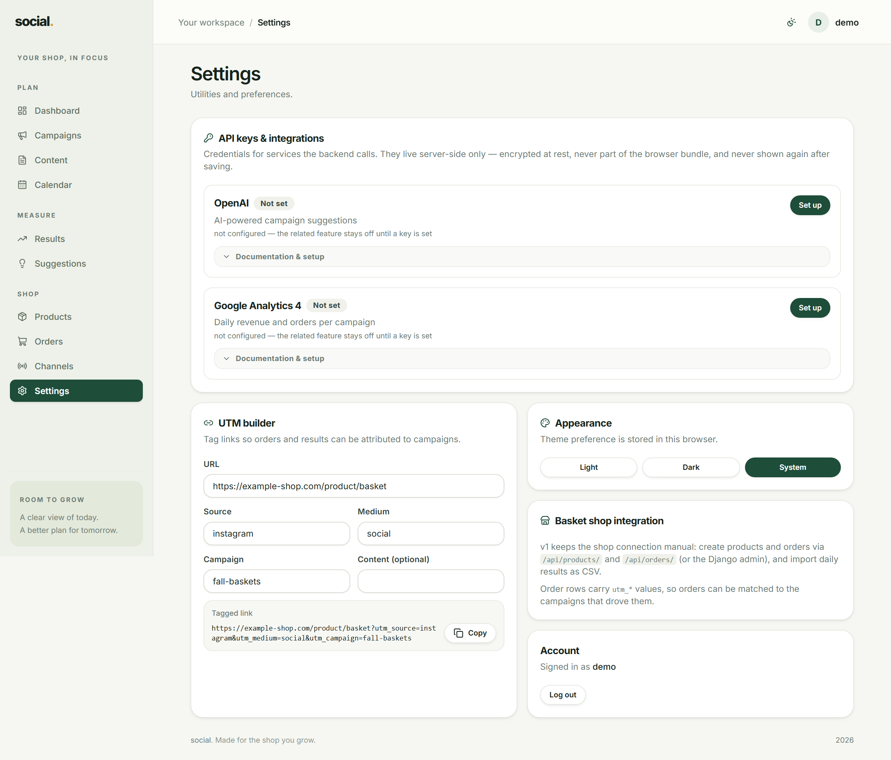
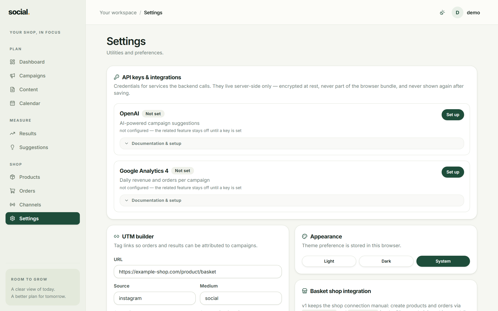

# Settings

Utilities and preferences: build tagged links, change the theme, connect Google Analytics, back
up your data, and see who you are signed in as.



## UTM builder

A **UTM tag** is the small set of labels you add to the end of a link so that every visit can be
traced back to the campaign that produced it. Without tags, a click is just an anonymous visit.

The builder takes a plain link and the labels, and gives you the tagged link back:

| Field | What goes in it | Example |
| --- | --- | --- |
| **URL** | The page you are sending people to. | `https://your-shop.com/product/basket` |
| **Source** | Where the click came from (the platform). | `instagram` |
| **Medium** | The type of traffic. | `social`, `email`, `cpc` |
| **Campaign** | **The campaign's UTM campaign value.** | `fall-baskets` |
| **Content** *(optional)* | Which variant of the post. | `story-vs-feed` |

Press **Copy** and use that link wherever you post it:

```
https://your-shop.com/product/basket?utm_source=instagram&utm_medium=social&utm_campaign=fall-baskets
```

!!! tip "Always copy from here, never retype"
    A typo in `utm_campaign` breaks attribution silently — the visit arrives, but it is
    attributed to nothing. Copying removes the typo, and keeps the spelling identical to the
    campaign's **UTM campaign** field, which is what Google Analytics matching relies on.

Naming habits that save you trouble later:

- **Source**: the platform name — `instagram`, `facebook`, `tiktok`, `google`, `newsletter`.
- **Medium**: lowercase, no spaces — `social`, `email`, `cpc`, `story`.
- **Campaign**: the same value as the campaign's UTM campaign — lowercase with hyphens.

## Appearance

Choose **Light**, **Dark** or **System** (follow your operating system). The choice is stored
in this browser, so it is per-device rather than per-account.

## API keys

This card lists the external services the backend can call. Each entry shows whether it is
configured, where the value came from, and — for Google Analytics — when it last synced. Expand
**Documentation & setup** on any card for the official steps and a link to the provider's
console, so you do not have to remember where the keys come from.



### What the keys are for

| Service | What it enables | If it is not set |
| --- | --- | --- |
| **OpenAI** | **Generate AI** suggestions on a campaign. | AI suggestions are unavailable; rule suggestions still work. |
| **Google Analytics 4** | Automatic revenue and orders in [Results](results.md) via **Sync now**. | You import results by CSV instead. |

### Setting up Google Analytics

To have the app pull GA4 numbers automatically, someone needs to:

1. Create a service account in Google Cloud and download its **JSON key file**.
2. In Google Analytics, give that service account's email address **Viewer** access to the GA4
   property.
3. In the app: **Settings → API keys → Google Analytics 4 → Set up**, paste the whole JSON key
   file into the credentials box, type the **GA4 property id**, and **Save**.
4. Press **Sync now**. The last 7 days of revenue and orders are imported.

After that, the card shows **Configured** and *last synced …*. Press **Sync now** whenever you
want fresh numbers — it is safe to run as often as you like, because it updates rather than
duplicates.

!!! note "Only staff accounts can change keys"
    The values are stored server-side, encrypted, and are never shown again after saving — the
    box is write-only. Other users can see whether a key is set, but saving is restricted to
    staff. **Leave a field blank to keep the current value** when you only want to change the
    property id.

!!! warning "Never paste keys into a chat, an email or a ticket"
    The credential box is the only place a key should go.

If the card ever shows **"Saved key can't be decrypted"**, the server's secret key changed
after the credential was saved. Remove the credential and save it again.

## Basket shop integration

This version keeps the shop connection manual: products and orders are created in the app (or
through the API / Django admin), and daily results are imported as CSV. Order rows carry their
`utm_*` values, which is what makes campaign attribution possible — see [Shop](shop.md).

## Backup & restore

The **Backup & restore** card moves your data out of the app and back in.

- **Download data (JSON)** — a readable copy of your campaigns, channels, content, results, ad
  spend, tasks, suggestions, products and orders. Accounts, passwords and saved API keys are not
  included.
- **Download database (SQLite)** — the whole database file, accounts included. Use this if the
  app runs on the built-in SQLite database.

To restore, pick a file and press **Restore from file**. Restoring **replaces** your current data
rather than merging it:

- a **JSON** backup replaces all business data and keeps your accounts;
- a **`.sqlite3`** file replaces the whole database (the previous file is kept as a `.bak` copy
  next to it) and needs a server restart.

!!! warning "Restoring cannot be undone"
    Take a fresh backup first if you are not sure. Only a staff (admin) account can restore.

## Account

Shows the username you are signed in as, and a **Log out** button. There is no self-service
password change here; ask whoever runs the app.
