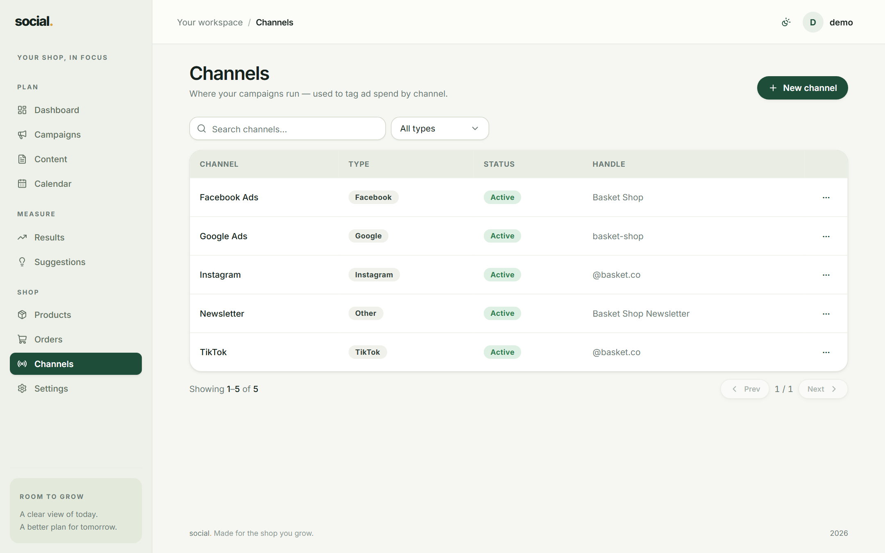
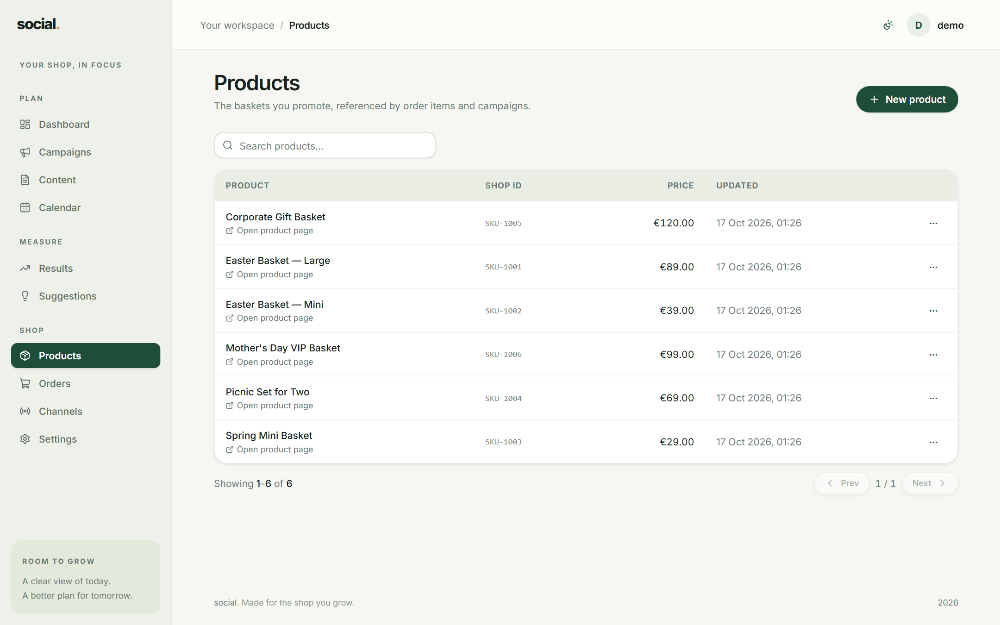
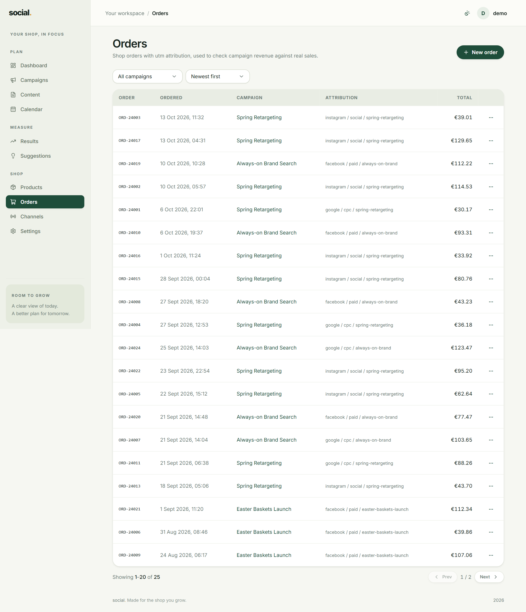

# Shop

**Shop** is the three things your campaigns point at: the **Channels** you publish on, the
**Products** you sell, and the **Orders** that come back. Keeping orders here is what lets you
say *"this campaign earned €1,240"* with a straight face.

!!! note "Nothing is connected to your real shop yet"
    Products and orders are entered in this app (by hand or through the API). There is no live
    connection to WooCommerce or Shopify in this version — so you only need to record what you
    want to analyse.

## Channels

A channel is a place you publish: Instagram, TikTok, Google, and so on. They are used in two
places:

- **Content** — to say where a post will go.
- **Ad spend** — to say which platform a spend row belongs to.

| Field | Example | Notes |
| --- | --- | --- |
| **Name** | `Main Instagram` | Anything you recognise. |
| **Type** | `Instagram` | Facebook, Instagram, TikTok, Google, X or Other. |
| **Handle** | `@your.shop` | Optional. |

## Products

Your catalogue, used to describe what a campaign is selling. Search by name, or add one with
**New product**:

| Field | Example | Notes |
| --- | --- | --- |
| **Name** | `Easter basket — large` | Required. |
| **Shop ID** | `SKU-123` | The id from your real shop, if you have one. |
| **Price (€)** | `39.90` | |
| **Product URL** | `https://shop.example.com/easter-basket` | Optional. |

## Orders

Orders are the money coming in, one row each. **New order** asks for:

| Field | Example | Notes |
| --- | --- | --- |
| **Order ID** | `WEB-1042` | The id from your real shop. |
| **Total (€)** | `49.90` | Required. |
| **Campaign** | `Fall baskets` | Optional but recommended — this is the attribution. |
| **Ordered at** | `2026-10-12` | Optional; defaults to now. |

### Attribution

The orders table has an **Attribution** column showing the UTM tags that came with the order —
`utm_source`, `utm_medium` and `utm_campaign`. That is the trail from a tagged link all the way
to a sale.

So the full story of one sale is:

1. You post a link tagged `utm_campaign=fall-baskets` (built in
   [Settings → UTM builder](settings.md#utm-builder)).
2. A customer clicks it, lands on your shop and buys.
3. The order arrives with those tags.
4. The **Attribution** column shows `fall-baskets`, and you know which campaign to thank.

!!! tip "Two levels of tracking"
    **Orders** give you the story one sale at a time (which link, which campaign).
    **Daily metrics** give you the totals the [Dashboard](dashboard.md) adds up. They are
    separate: recording an order does not by itself change the Dashboard's revenue. Record the
    daily totals in [Results](results.md) for that.

Filter the orders list by campaign to see only the sales a campaign produced.
