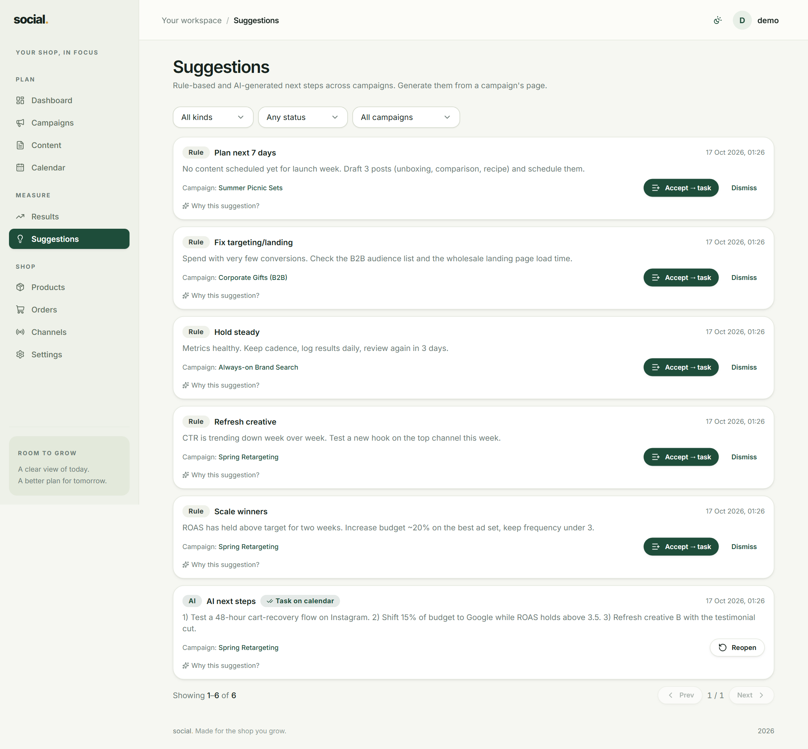

# Suggestions

Suggestions are next-step ideas generated from your own numbers — *"this campaign's ROAS is
below 1, consider pausing it"* — so you do not have to stare at the Dashboard wondering what
to change.

## Generating them

Suggestions are created **from a campaign**, not from this page. Open a campaign, go to the
**Suggestions** tab, and pick one:

| Button | Needs | What it does |
| --- | --- | --- |
| **Generate rules** | Nothing | Reads your recorded numbers and applies fixed rules. Always available. |
| **Generate AI** | An OpenAI key | Asks an AI model for written recommendations. |

The AI button needs an OpenAI key to have been added in
[Settings → API keys](settings.md#api-keys). Without one you will see a friendly notice
saying so — rule suggestions keep working regardless.

!!! tip "Start with rules"
    Rule suggestions cost nothing, run instantly, and are easy to understand because they are
    based on thresholds you can see. Use AI when you want advice phrased in words rather than
    a threshold.

## Reading the list

Each suggestion is a card showing:

- A **kind** badge — `Rules` or `AI`.
- A **title** and a sentence or two of **explanation**.
- The **campaign** it belongs to (clickable).
- When it was created.

Expand **"Why this suggestion?"** to see the exact numbers the suggestion was based on. It is
the honest answer to *"where did this come from?"*

## Acting on one

| Action | Result |
| --- | --- |
| **Accept → task** | Creates a task on that campaign and shows a *Task on calendar* badge. Find it in the campaign's **Tasks** tab or on the [Calendar](content-calendar.md). |
| **Dismiss** | Marks it as handled so it stops cluttering the list. |
| **Reopen** | Puts a dismissed or accepted suggestion back to open. |

Accepting does not change any data — it just gives you a dated to-do so the idea does not get
lost.

## Filtering

At the top of the page you can filter by **kind** (`Rules` / `AI`), by **status** (`Accepted` /
`Not accepted`) and by **campaign**. Handy before a weekly review: filter to *Not accepted* and
deal with what is left.
